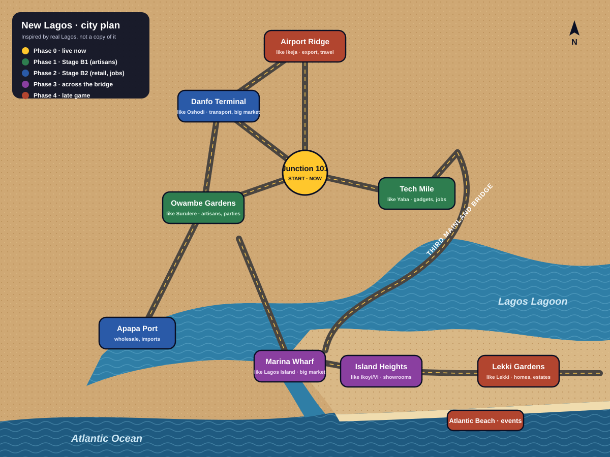

# New Lagos: city plan and roadmap

New Lagos follows the shape of real Lagos, so players who know the city recognise it straight away:
- the **Mainland** sits in the north;
- the **Lagos Lagoon** cuts across the middle;
- the long **Third Mainland Bridge** crosses the lagoon to the **Island**;
- **Lekki** runs east along the coast;
- the **Atlantic** is in the south.

The plan follows Lagos geography (OpenStreetMap, general knowledge), but is drawn from scratch. No map data or geometry is copied. District names are the game's own. The "like Yaba" notes in the image are only design references and never show in the game.

## Districts

| Phase | District | Real-Lagos feel | What it is in the game | Opens with |
|---|---|---|---|---|
| 0 | **Junction 101** | Mushin/Surulere crossroads | Start: Market Square, Work Hub, Hangout, player shops | Live now |
| 1 | **Tech Mile** | Yaba ("Yabacon Valley") | Gadget plugs, phone repair, tech jobs | Stage B1 |
| 1 | **Owambe Gardens** | Surulere | Artisans: tailors, decorators, caterers, event halls. Artisan quotes live here. | Stage B1 |
| 2 | **Danfo Terminal** | Oshodi | Transport hub and big open market, jobs board, retail | Stage B2 |
| 2 | **Apapa Port** | Apapa | Wholesale and imports: cheaper bulk stock, container deliveries | Stage B2 |
| 3 | **Marina Wharf** | Lagos Island, Marina, Balogun | Big market across the bridge, higher prices, more customers | After the bridge |
| 3 | **Island Heights** | Ikoyi, Victoria Island | Showrooms and premium shops: the "showroom" and "market royalty" dreams | After the bridge |
| 4 | **Lekki Gardens** | Lekki | Homes and estates: buy and decorate your own house | Late game |
| 4 | **Airport Ridge** | Ikeja | Export and travel deals, the "junction legend" goal | Late game |
| 4 | **Atlantic Beach** | Elegushi / Bar Beach | Events, weekend hangouts, owambe parties | Late game |

**The bridge is a milestone.** Crossing Third Mainland unlocks the Island districts. It's a natural "you have made it" moment for the dream system.

## How the map grows

1. **Now (phase 0):**
   - Junction 101 on a 4800×3600 world;
   - four placeholder districts around it;
   - day and night by Lagos time;
   - moving danfos, okadas, kekes and walkers.
2. **Re-layout (before phase 1):**
   - Grow the world to about 9600×7200, with Junction 101 in the north-middle.
   - Move the four districts to the positions on the plan. Danfo Terminal goes north-west and Marina Wharf goes across the water.
   - Draw the lagoon and ocean as water shapes, with the shoreline and Third Mainland Bridge.
   - The level-of-detail rules still apply: far zoom shows district markers only, and close zoom shows buildings, traffic and people.
3. **Phases 1–4:** each district opens with its stage. Until then it shows buildings with an "Opens later" plate, as today.

## Art still needed (Stitch, same style, flat magenta background)

| For | Asset |
|---|---|
| Water | Lagoon shoreline pieces (straight, inner corner, outer corner), a sand-to-water edge, small wooden fishing boats, a ferry |
| Bridge | Third Mainland Bridge segments: straight, curve, on-ramp. Concrete on pillars over water. |
| Port | Container stacks, gantry crane, cargo ship, warehouse |
| Island | Glass office tower, luxury showroom, upscale apartment block, palm-lined boulevard pieces |
| Lekki | Duplex house, estate gate, beach shack, beach umbrellas |
| Airport Ridge | Small terminal building, control tower, cargo hangar |
| People | Three more walk sheets like the kaftan man's: market trader with a head pan, student with a backpack, woman in a gele. **All four rows must face one direction each:** row 1 up-right, row 2 up-left, row 3 down-right, row 4 down-left (export 9's row 1 mixed front and back views). |
| Traffic | Danfo, okada and keke from the two missing angles (heading up-right, heading down-left), and a BRT bus |

No real brand logos, carrier colours or readable plate numbers.
